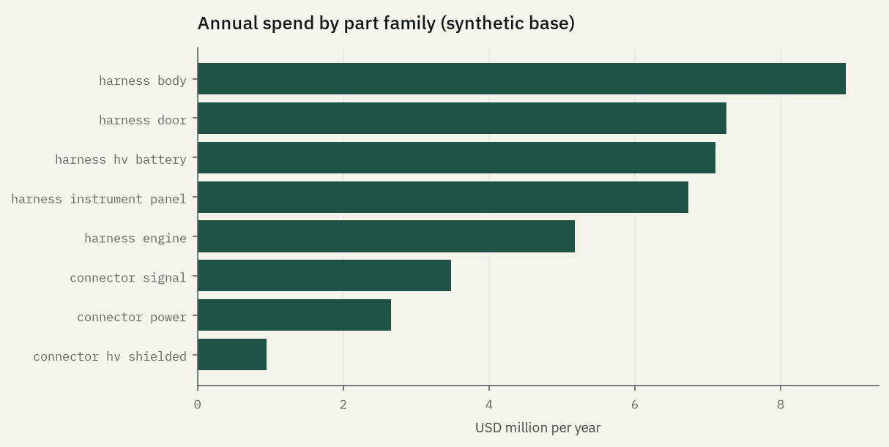
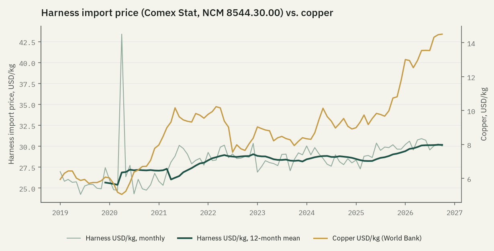
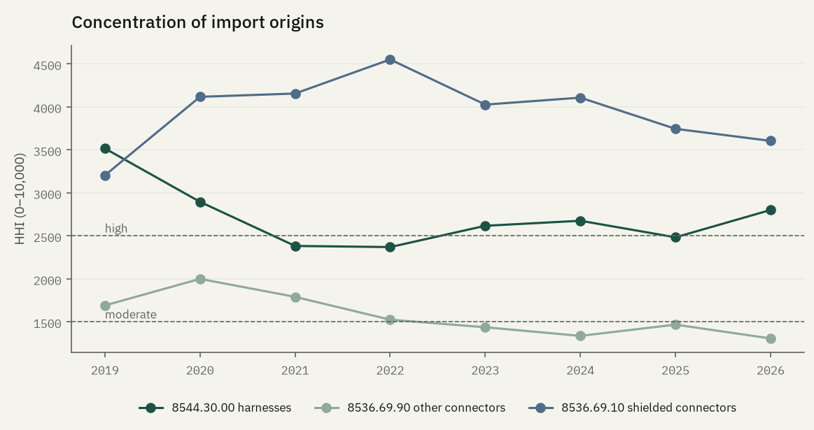
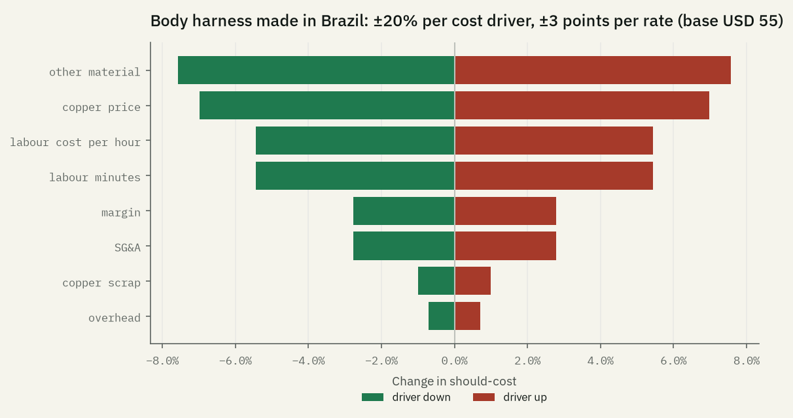
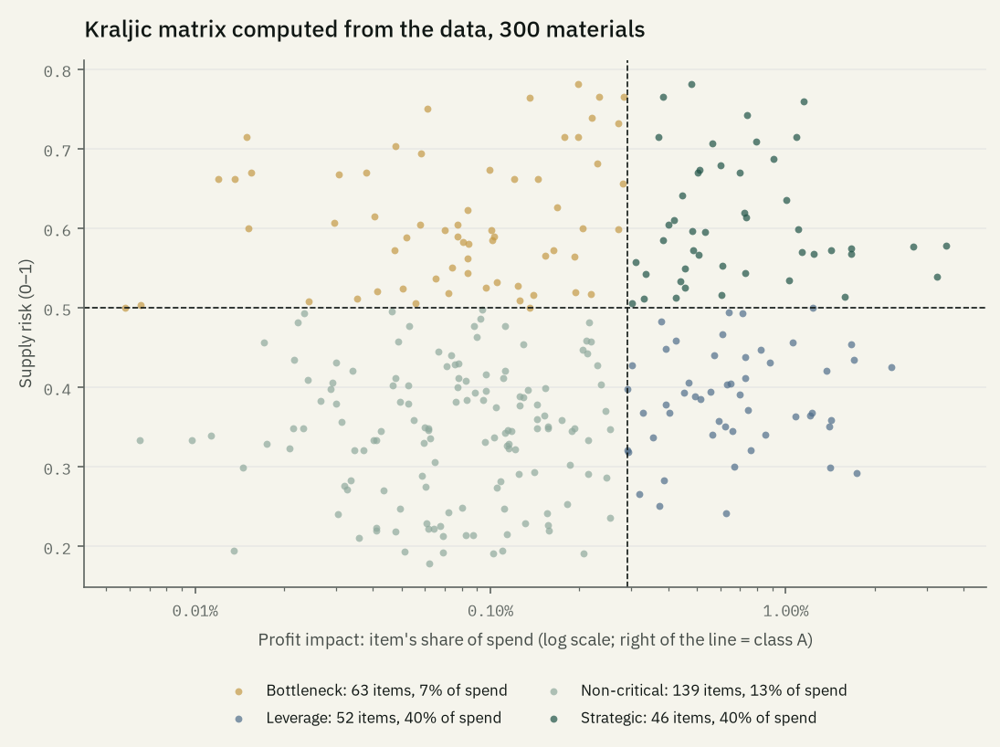
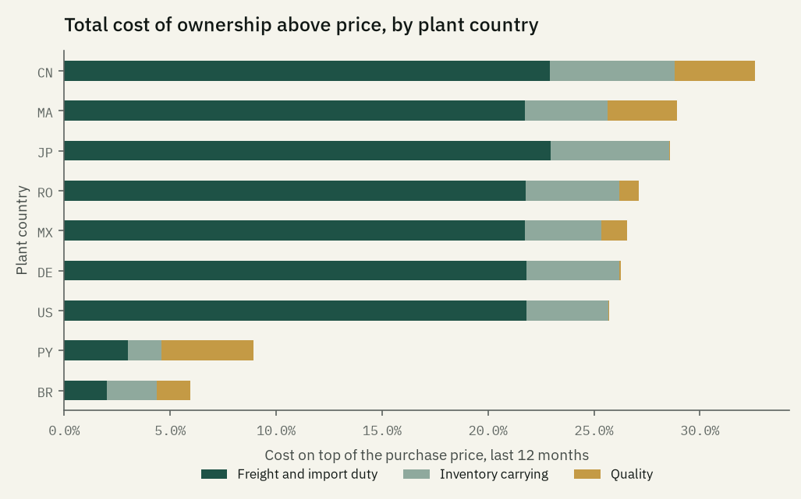

# Wire harness and connector should-cost

Technical design and backlog map: [docs/BLUEPRINT.md](docs/BLUEPRINT.md).

## Business question

What target price and sourcing strategy should a fictional automaker use for wire harnesses and connectors, and which copper price-adjustment clause minimizes total risk for both buyer and supplier?

**Problem statement**

1. Wire harnesses and connectors are critical, copper-heavy parts, and their prices move with copper, the exchange rate and supplier concentration.
2. The buyer pays quotes without an independent cost reference, so overpricing and single-source exposure go unnoticed.
3. Contracts either freeze prices for a year or pass every copper move through, shifting all the risk to one side of the table.
4. This project builds a bottom-up should-cost, calibrated on public import prices, and backtests four copper clauses over 2016–2026.
5. The output is a target price per part family, a sourcing strategy per supplier and a recommended clause for each side.

**KPIs**

| KPI | Definition | Unit |
|---|---|---|
| Should-cost gap | (quoted price − should-cost) / should-cost, per part family and supplier | % |
| Potential savings | Σ (quoted price − should-cost) × annual volume, for items with a gap above 10% | USD/year |
| Copper exposure | Change in annual spend for a 10% move in the copper price | USD per 10% |

**Scope of the category**

| NCM | Official description (Comex Stat) | Statistical unit | Import duty (II) |
|---|---|---|---|
| 8544.30.00 | Jogos de fios para velas de ignição e outros jogos de fios dos tipos utilizados em quaisquer veículos | kg (net) | 16.0% |
| 8536.69.10 | Tomada polarizada e tomada blindada, para uma tensão não superior a 1.000 V | units | 14.4% |
| 8536.69.90 | Outras tomadas de corrente, para uma tensão não superior a 1.000 V | units | 16.0% |

Connectors are counted in units, not kilograms, so the market analysis reports USD/kg for harnesses and both USD/kg (from net weight) and USD/unit for connectors.

Import duty rates are the reference TEC rates consulted on 2026-11-26 and are applied to imported supplies in the should-cost and TCO. They are kept in [data/reference/import_duty.csv](data/reference/import_duty.csv).

## Result

*Status: spend baseline, market intelligence, should-cost, supplier gaps, the copper clause, category strategy, TCO and the negotiation playbook. The dashboard and the executive memo come next.*

**Spend baseline (synthetic base, about USD 42 M per year).** Harnesses take 83% of spend; body harnesses alone are 21%. 98 of 300 materials (33%) make up 80% of spend, and single-source items are 20% of materials and 19% of spend. Suppliers belong to Brazilian, Japanese, German, US, Korean and Chinese groups but mostly build in low-cost plants: Brazil 25% of spend, Mexico 16%, Romania 14%, Paraguay 10%, China 10%, Morocco 9%.




**Market (real Comex Stat imports, 2019–2026).** Harness imports cost about USD 30/kg in 2025–2026, up from USD 25.6/kg in 2019. Month to month, import prices barely follow copper, so the should-cost will take copper pass-through from its cost tree rather than from market correlation. The April 2020 spike is a low-volume pandemic month.



**Origin risk.** Harness imports are highly concentrated, with Paraguay supplying 46–58% of value every year; shielded connectors depend on China for about 60%.



**Should-cost.** A bottom-up cost tree (copper, other material, labour by country, overhead, SG&A, margin, freight and import duty) lands within 3% of the 2025 import price per kg for Paraguay, Thailand and Germany, and within 12% for Japan. China, India and the small, likely more complex volumes from Mexico, the United States and Argentina import above the model. Connectors can't be calibrated on Comex Stat units, so their should-cost rests on the cost tree alone.


**Supplier gaps.** Regular suppliers price a median 3.7% above should-cost. Four suppliers pass both tests used to flag overpricing, a gap above 10% and more than two robust standard deviations above the other suppliers: S023 (+15.9%, Japanese plant), S003 (+14.8%, Morocco), S027 (+12.0%, China) and S006 (+11.3%, Japanese plant). The first three are the suppliers the generator gave a hidden markup; S006 is a false positive, because the should-cost underestimates high-wage plants, where labour weighs more. Bringing every material-supplier pair above 10% back to should-cost is worth about USD 0.57 M per year, 88% of it with the flagged suppliers.


**What moves the should-cost.** For a body harness made in Brazil, other material and copper are the largest drivers (±7–8% of should-cost for a ±20% change), followed by labour cost and labour minutes (±5.5%). Margin and SG&A move it ±2.8% for ±3 points. Negotiations should therefore start from the material bill and the copper index, not from margin.



**Copper clause.** Four price-adjustment designs, backtested on real copper from 2016 to 2026 for a body harness made in Brazil:

| Design | Budget drift in the year | Price changes in 10 years | Paid vs. monthly | Supplier margin: spread | Supplier margin: worst month |
|---|---|---|---|---|---|
| Fixed annual | 0.0% | 10 | −1.1% | 2.6 points | −0.5% |
| Monthly pass-through | 2.0% | 128 | 0.0% | 1.0 point | 4.3% |
| Quarterly, 3-month lag | 1.7% | 43 | −0.4% | 1.9 points | 2.1% |
| ±5% band | 1.9% | 33 | 0.0% | 1.2 points | 4.2% |

A fixed annual price gives the buyer a certain budget and the lowest total cost, but pushes all copper risk onto the supplier, whose yearly margin fell below 3% in 2021 and 2026 and went negative in December 2025. Monthly pass-through protects the supplier but moves the price every month. **Buyer's opening position: fixed annual. Supplier's: monthly pass-through. Recommended landing zone: quarterly adjustment on the previous quarter's average copper**, the design whose weaker side is least weak; the ±5% band is the alternative if the supplier insists on margin protection, at the cost of a little more budget drift. The same ranking holds for a harness made in China and for signal connectors.


**Category strategy.** A Kraljic matrix computed from the data, not filled in by judgement: profit impact is ABC class A, supply risk is the mean of supplier concentration, lead time, import exposure outside Mercosur and origin concentration in Comex Stat. 46 items holding 40% of spend are **strategic** and 52 items holding another 40% are **leverage**, all harnesses; connectors fall mostly in **bottleneck** and **non-critical**, small in spend but with real supply risk. Import exposure separates the two halves most: 95–97% of high-risk spend comes from outside Mercosur, against 30–39% for low-risk items, so Brazilian and Paraguayan plants are the main lever against supply risk. 14 of 60 suppliers score as high risk; 3 of them (two Chinese plants and one Mexican) hold mostly items they supply alone and should get a second source. S023 and S006 are both flagged on price and high risk, which makes them the first suppliers to address.

| Quadrant | Items | Share of spend | Action |
|---|---|---|---|
| Strategic | 46 | 40% | 3-year agreements with the quarterly copper clause; second source for single-source items; cost reviews against should-cost |
| Leverage | 52 | 40% | Annual competitive RFQ against should-cost; consolidate volume |
| Bottleneck | 63 | 7% | Safety stock sized to lead time; qualify an alternative or Mercosur source |
| Non-critical | 139 | 13% | Catalogue or framework pricing; fewer suppliers |



**Total cost of ownership.** Freight, import duty, inventory carried over the lead time and quality cost add 26–33% to the price of parts imported from outside Mercosur, against 6–9% for Brazilian and Paraguayan plants. In 122 of the 240 multi-source items, the cheapest price is not the cheapest TCO, so price-only sourcing decisions are wrong about half the time.



**Negotiation playbook** ([reports/negotiation_playbook.md](reports/negotiation_playbook.md)). For each flagged supplier: position, BATNA (the lowest-TCO alternative for its items), the zone of possible agreement from the supplier's floor (its cost without margin) to the buyer's walk-away (the price at which switching becomes cheaper), an opening offer and the concessions to trade. S003 (German group, plant in Morocco) has a real zone, from 19% to 8% below today's price: aim at should-cost, 13% below. For S027 the alternatives already beat should-cost, so the aim is the walk-away, 16% below. For the two Japanese plants, S023 and S006, there is no zone at all: the alternatives' TCO sits below anything they could accept, so the plan is to move volume in stages and ask for should-cost only to bridge the transition.

Figures are regenerated from the database with `python -m src.figures`, in the colours and type of the Stephany Alves Design System (`src/brand.py`; IBM Plex Sans and Mono, with system fallbacks when they are not installed).

## Data

- **Synthetic purchasing base** for a fictional automaker: 60 suppliers, 300 materials, about 5,600 purchase order lines over 24 months and 300 RFQs with 3 quotes each, about USD 42 M of spend per year. Prices are built bottom-up from the real copper price (World Bank Pink Sheet, lagged 3 months), other material and labour priced in each supplier's plant country; three suppliers carry a hidden markup. Every assumption is listed in [docs/assumptions.md](docs/assumptions.md).
- Public sources and extraction dates are logged in [data/README.md](data/README.md).

## Method

1. **Spend baseline** ([notebooks/01_spend.ipynb](notebooks/01_spend.ipynb)): spend cube by family, supplier country and year; ABC Pareto (A while cumulative spend before the item is under 80%, B under 95%); single-source exposure; purchase price variance against the last price paid. The SQL lives in [sql/views.sql](sql/views.sql), and `python -m src.validate` checks the base before any analysis.
2. **Market intelligence** ([notebooks/02_market.ipynb](notebooks/02_market.ipynb)): Comex Stat implied import prices (USD/kg, and USD/unit for connectors), origin concentration (HHI) and the correlation of import prices with copper at lags of 0 to 6 months. Harness imports run at about USD 30/kg with Paraguay supplying close to half; month-to-month import prices barely follow copper, so the should-cost takes copper pass-through from its cost tree and calibrates on annual averages.
3. **Should-cost** ([notebooks/03_should_cost.ipynb](notebooks/03_should_cost.ipynb), [src/should_cost.py](src/should_cost.py)): cost tree per unit for every material and supplier, priced with the supplier country's labour cost, then landed in Brazil with freight and import duty (Mercosur origins duty-free). Calibrated against Comex Stat USD/kg by origin; premises are listed in [docs/assumptions.md](docs/assumptions.md).
4. **Gaps and sensitivity** ([notebooks/04_gap.ipynb](notebooks/04_gap.ipynb), [src/gap.py](src/gap.py)): each PO line and quote is compared with its should-cost at the same date (copper lagged 3 months). A supplier is flagged when its spend-weighted gap is above 10% and more than two robust standard deviations (MAD) above the median supplier. Savings potential counts the last 12 months of spend above should-cost for material-supplier pairs above 10%. The tornado moves one driver at a time.
5. **Copper clause backtest** ([notebooks/05_clause.ipynb](notebooks/05_clause.ipynb), [src/clause.py](src/clause.py)): the contract price is the should-cost at an index value of copper; four designs (fixed annual on December copper, monthly on the previous month, quarterly on the previous quarter's average, a ±5% band) are run on the Pink Sheet series from 2016. The supplier buys copper at spot, so its margin shows who carries the risk. Buyer metric: mean drift of the price from the January price; supplier metric: spread of its margin.
6. **Category strategy** ([notebooks/06_strategy.ipynb](notebooks/06_strategy.ipynb), [src/strategy.py](src/strategy.py)): Kraljic per material, with impact from the ABC class and supply risk as the mean of four factors scaled 0–1 (high from 0.5); a supplier risk score from dependency on single-source items (35%), lead time (25%), quality in PPM (20%) and import exposure (20%); actions per quadrant and per supplier.
7. **TCO and negotiation** ([notebooks/07_tco_playbook.ipynb](notebooks/07_tco_playbook.ipynb), [src/tco.py](src/tco.py), [src/playbook.py](src/playbook.py)): TCO per unit = landed price (freight, import duty outside Mercosur) + inventory carrying at 20% a year over lead time plus 15 days + quality cost from PPM. Each supplier's BATNA is the lowest-TCO other source for the same items (current suppliers and RFQ bidders). `python -m src.playbook` writes the playbook for flagged suppliers.

## Limitations

## How to run

```bash
python -m venv .venv
source .venv/Scripts/activate   # Windows Git Bash; use .venv/bin/activate on macOS/Linux
pip install -r requirements.txt
nbstripout --install            # once per clone: strips notebook outputs on commit
python -m src.data.download_pinksheet   # loads the copper series into copper_monthly
python -m src.generate.purchasing   # builds data/processed/purchasing.duckdb
python -m src.data.download_comexstat   # loads Comex Stat imports into market_monthly
```

Before committing:

```bash
ruff check .
ruff format .
pytest
```

## How AI was used
