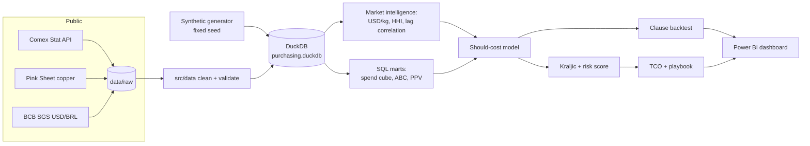

# Blueprint: Wire harness and connector should-cost

Technical design for this project. The backlog lives in the [epic](https://github.com/stephanyalves-eng/p1-wire-harness-should-cost/issues/1); each section below names the issues that deliver it.

## 1. Business question

What target price and sourcing strategy should a fictional automaker use for wire harnesses (NCM 8544.30) and connectors (NCM 8536.69), and which copper price-adjustment clause minimizes total risk for both buyer and supplier?

**Decision supported:** target price per part family, sourcing strategy per supplier (single, dual, renegotiate) and the index clause to propose in the next contract round.

**Why this category:** wire harnesses and connectors are critical items in electric vehicles and aircraft, and copper drives most of their cost volatility. The same model serves the buyer side (target price) and the supplier side (margin protection).

## 2. Scope

| In scope | Out of scope |
|---|---|
| Synthetic purchasing base for one fictional automaker (60 suppliers, 300 parts, 24 months) | Real company prices or contracts |
| Public import data (Comex Stat) and public copper prices (World Bank Pink Sheet) | Tooling, NRE and engineering change costs |
| Bottom-up should-cost per part family, clause backtest, Kraljic, TCO | Demand forecasting |
| Power BI dashboard and a 1-page executive memo | Oil and gas variant (stretch only, see section 11) |

## 3. KPIs and acceptance

| KPI | Definition | Target / check |
|---|---|---|
| Should-cost gap | (quoted price − should-cost) / should-cost, per part family | Reported per supplier; flagged when above 10% |
| Potential savings | Σ (quoted − should-cost) × annual volume, for flagged items | USD/year, reconciled to the spend cube |
| Copper exposure | Change in annual spend for a 10% copper move | USD per 10%, by part family |
| Model calibration | Should-cost vs. Comex Stat implied USD/kg | Within ±15% on the calibration families |
| Data integrity | Validation suite on the synthetic base | 100% of checks pass in CI |

## 4. Data sources

| Source | What it provides | Access | License | Script |
|---|---|---|---|---|
| [Comex Stat (MDIC)](https://api-comexstat.mdic.gov.br/docs) | Monthly imports by NCM and country: USD FOB, kg | Public REST API, no key | Brazilian open data | `src/data/download_comexstat.py` |
| [World Bank Pink Sheet](https://www.worldbank.org/en/research/commodity-markets) | Monthly copper price (USD/t) since 1960 | Excel download | CC BY 4.0 | `src/data/download_pinksheet.py` |
| Banco Central do Brasil, SGS | Daily USD/BRL exchange rate | Public API | Brazilian open data | `src/data/download_fx.py` |
| TEC (Tarifa Externa Comum) | Import duty (II) for the 8-digit NCM codes | Public table | Public | Recorded manually in `data/README.md` |
| Synthetic generator | Suppliers, materials, purchase orders, quotes | `src/generate/purchasing.py` | Generated, MIT | Seeded, reproducible |

Raw downloads stay in `data/raw/` (git-ignored). Every source is logged in `data/README.md` with link, extraction date and license.

## 5. Data model and pipeline



**DuckDB schema (issue #3)**

| Table | Grain | Key columns |
|---|---|---|
| `suppliers` | 1 row per supplier (60) | supplier_id, country, lead_time_days, ppm, is_overpriced (hidden truth) |
| `materials` | 1 row per part (300) | material_id, family, ncm, copper_g_per_unit, single_source |
| `purchase_orders` | 1 row per PO line (~5,000, 24 months) | po_id, material_id, supplier_id, order_date, qty, unit_price_usd |
| `quotes` | 3 quotes per RFQ | rfq_id, material_id, supplier_id, quote_date, unit_price_usd |
| `market_monthly` | 1 row per month × NCM × country | month, ncm, country, usd_fob, kg, implied_usd_kg |
| `copper_monthly` | 1 row per month | month, copper_usd_t |

## 6. Method by stage

| Stage | Issues | Method | Output |
|---|---|---|---|
| Framing | #2 | Problem statement in 5 lines; confirm 8-digit NCM split and II rate in the TEC | `README.md` business question and KPIs |
| Synthetic base | #3, #4 | Price = copper cost lagged 3 months + conversion + noise; 20% single-source items; 3 suppliers with 8–15% overprice | `purchasing.duckdb`, generator with seed |
| Validation and SQL | #5 | No negative POs, coherent dates, spend total matches the defined target; spend cube, ABC Pareto, single-source share, PPV vs. last price paid | `sql/*.sql`, tests |
| Market intelligence | #6, #7 | Implied USD/kg = FOB / kg; HHI of import origin; correlation with copper at lags 0–6 months | `notebooks/02_market.ipynb` |
| Should-cost | #8, #9 | Cost tree: copper, insulation, terminals, machine and assembly minutes per circuit, overhead, SG&A, margin, freight, II, FX; calibrate on Comex Stat; tornado sensitivity | `src/should_cost.py`, tornado chart |
| Clause backtest | #10 | 2016–2026 monthly copper, 4 designs: fixed annual, full monthly pass-through, quarterly with 3-month lag, ±5% band; buyer price volatility vs. supplier margin variance | Clause comparison table, recommendation per side |
| Category strategy | #11 | Kraljic computed from data: impact = spend share, risk = HHI + single source + lead time; supplier risk score | Kraljic chart, risk table |
| TCO and negotiation | #12 | TCO = price + freight + II + inventory carrying cost from lead time + quality cost from PPM; BATNA, ZOPA from should-cost, concession plan | `reports/negotiation_playbook.md` |
| Delivery | #13, #14 | Power BI: Spend, Market, Should-cost, Clause pages; 1-page memo; README case study | v1.0 release |

## 7. Repository layout

```
src/
  data/download_comexstat.py   # API extraction, idempotent, logs extraction date
  data/download_pinksheet.py
  data/download_fx.py
  generate/purchasing.py       # synthetic base, fixed seed
  should_cost.py               # cost tree and calibration
  clause_backtest.py           # 4 clause designs
  kraljic.py                   # scoring and quadrant assignment
sql/                           # spend cube, ABC, PPV, single-source share
notebooks/
  01_spend.ipynb
  02_market.ipynb
  03_should_cost.ipynb
  04_clause_and_strategy.ipynb
dashboard/should_cost.pbix
reports/memo.pdf, negotiation_playbook.md
tests/                         # validations and key-number checks
```

## 8. Validation and tests

- **Generator truth recovery:** the analysis must flag the 3 overpriced suppliers that the generator marked, and the share of single-source items must come out at 20% ± 1 pp.
- **Data checks (pytest):** no negative quantities or prices, order dates inside the 24-month window, spend total equals the configured target.
- **Calibration check:** should-cost per family within ±15% of the Comex Stat implied USD/kg for the same period.
- **Clause backtest sanity:** full monthly pass-through must give zero supplier margin variance from copper; fixed annual must give zero buyer price volatility within a year.
- CI runs `ruff check`, `ruff format --check` and `pytest` on every PR.

## 9. Deliverables and releases

| Release | Milestone | Content |
|---|---|---|
| v0.1 | Sprint 1 (ends 6 Dec 2026) | Synthetic base, SQL spend analysis, market intelligence notebook |
| v1.0 | Sprint 2 (ends 20 Dec 2026) | Should-cost model, clause backtest, Kraljic, TCO, playbook, Power BI dashboard, memo, case study |

## 10. Assumptions and risks

| Item | Mitigation |
|---|---|
| Comex Stat implied USD/kg mixes many products under one NCM | Calibrate on families, report the range, not a single point |
| Copper content per part is assumed | Document grams per unit per family with a public source or engineering estimate |
| Comex Stat API limits or schema changes | Cache raw responses in `data/raw/`; fall back to the bulk CSV |
| Synthetic data can look too clean | Add noise, missing values and outliers on purpose, and say so in the README |

## 11. Stretch

Oil and gas variant: repeat the should-cost stage for seamless OCTG tubes (NCM 7304.29), using a steel price series from FRED and ANP production investment forecasts as the demand driver.

## 12. Division of work with AI

Claude writes the data generator, API scripts and reviews SQL and DAX. Cost assumptions, interpretation of results and the final recommendation are mine, and every assumption carries a source or a written justification.
